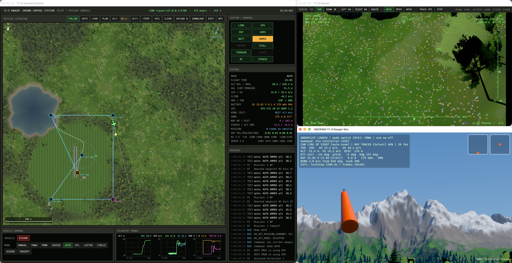

# SIM001

SIM001 is a Bevy 0.20 flight simulator for practising with small FPV planes. It supports two planes of the HEEWING T1-S, and both are complete: the **T1-S Ranger**, a plain twin-motor plane with no flight controller, and the **T1-S VTOL**, with two tilt-rotors, a rear rotor and an ArduPilot flight controller.

- **Rasterized lighting** with shadow maps and a physical sky from Bevy's atmosphere, by default. Add `--raytrace` for optional ray-traced shadows, global illumination and reflections using Bevy Solari. It runs on Apple Silicon M3/M4 through Metal hardware ray tracing.
- **Flight model:** a 6-DOF model built from strip theory. Each wing section and V-tail panel sees its own airflow, including rotation, prop wash and wing downwash. Stability, stalls, tip stalls, adverse yaw, dihedral effect and V-tail coupling come out of the geometry. The model also includes twin-motor thrust with differential thrust, a 4S LiPo with voltage sag, wind with a boundary-layer profile and turbulence, ground contact, prop strikes, and collisions with trees and buildings.
- **Controls:** a RadioMaster TX15 (or any EdgeTX/OpenTX radio) as a USB joystick, a Nintendo Switch Pro Controller, or the keyboard.
- **ArduPilot:** the sim can act as the physics backend for ArduPlane SITL through the JSON interface. It runs in lockstep and forwards your sticks to ArduPilot as RC input.

## Run

There are two planes (`--aircraft`):

- **`t1s-vtol`, the default:** the T1-S VTOL, with two tilt-rotors and a rear rotor, and a flight controller. ArduPilot flies it. The sim starts ArduPilot for itself, so this is all it takes (B arms, N picks the next mode, QHOVER is the first):

  ```bash
  ardupilot/build_native.sh        # once: builds ArduPlane SITL natively into .ardupilot/ (no Docker)
  cargo run --release              # the VTOL, with its own ArduPilot
  ```

  Without a native build the sim uses the Docker image `sim001-ardupilot-sitl` if it is built. For missions and the console, start the whole station, which starts the sim, the ground control console and ArduPilot together:

  ```bash
  cd domains/teleoperation/console && cargo run --release -- --station
  ```

- **`t1s-ranger`:** the plain T1-S. It has only a receiver and two ESCs, no flight controller, so it has no ArduPilot, no console and one flight mode (MANUAL). Fly it from the keyboard or a radio:

  ```bash
  cargo run --release -- --aircraft t1s-ranger              # rasterized, with shadow maps
  cargo run --release -- --aircraft t1s-ranger --raytrace   # ray traced (Apple Silicon M3/M4 or other hardware RT)
  cargo run --release -- --selftest                         # headless flight-model numbers
  ```

`rust-toolchain.toml` pins Rust 1.99, which Bevy 0.20 needs. rustup installs it automatically.

**Sleep and gaming mode.** While the sim runs it keeps the computer awake (no display or system sleep): a power assertion on macOS (check with `pmset -g assertions`), `SetThreadExecutionState` on Windows, and `systemd-inhibit` on Linux, where it also asks Feral's GameMode (`gamemoded`) to tune the process if it is installed. The Windows and Linux paths are untested. `--fullscreen` starts borderless full screen, and F11 toggles it. macOS Game Mode can't be switched on from code: macOS turns it on for a full-screen app that its bundle marks as a game, so run `cargo build --release && tools/macos-app.sh && open "target/release/T1-S Sim.app" --args --fullscreen`. On Windows, Game Mode applies to a full-screen game by itself.

## Launcher and app bundle

The launcher ([domains/teleoperation/launcher](domains/teleoperation/launcher/README.md)) sets up your controllers, opens the docs and starts the sim alone or the whole station, with or without ArduPilot. `tools/bundle.sh` packs it with the sim, the ground station, ArduPlane SITL, the maps and the manual into one app: `target/bundle/SIM001.app` on macOS (and a zip), a folder and tar.gz on Linux, a folder and zip on Windows (untested). Build it on the OS you want it for. `controls.cfg` and the flight logs go to the user's data folder (`~/Library/Application Support/SIM001` on macOS). The first run copies `controls.cfg.example` there (a TX15 in joystick mode); the radio wizard replaces it.

## Real places

Besides the Alpine Valley, the sim flies real places built from USGS lidar elevation, NAIP aerial photos and OpenStreetMap. Trees and water are derived from the photos. The two built so far are **Cypress Island Airfield, WA** (`cypress`) and the **Park at the Berkeley Waterfront, CA** (`berkeley`):

```bash
cd domains/teleoperation/console && cargo run --release -- --station --map cypress   # builds the map pack the first time
cargo run --release -- --map berkeley                     # the sim alone
```

See [maps/README.md](maps/README.md) for the data, licenses and how to add a place.

## Scenery and rendering

The setting is an alpine valley modelled on Rocky Mountain lakes:
- **Mountains:** domain-warped ridged-noise mountains with granite faces and snow.
- **Forest:** about 24,000 trees, narrow subalpine fir and spruce up to a ragged treeline with a few aspen groves, grown by our own generator (`domains/visualization/engine/src/treegen.rs`). It grows recursive branches with taper, gnarl and gravity, then adds painted needle sprays and leaf clusters on alpha-cut cards. Solari has no alpha support, so each tree also carries an invisible solid proxy that only the ray tracer sees, for shadows, reflections and GI. Beyond about 300 m the trees switch to a cheap solid crown.
- **Ground cover:** 3D grass and alpine flowers (daisies, avens, lupine) stream in around the camera when it's near the ground. The mown field gets short turf, the meadows tall grass with flower drifts, and the forest floor moss.
- **Rocks:** granite boulders, outcrops and shoreline cobbles.
- **Lake:** a still mirror lake with an irregular, grassy shoreline and cobbles at the waterline. It is a mirror over its own bed: stones and silt show in the shallows and fade to dark where it is deep, with the reflections taking over at a grazing angle.
- **Clouds:** a field of fair-weather cumulus, flat-bottomed, out to the horizon. The ray tracer does not see them, so they neither reflect in the lake nor shade the ground.
- **Haze:** far ridges fade into blue, as through real air. Solari ignores Bevy's `DistanceFog`, so the ray-traced view has its own pass (`domains/visualization/engine/src/haze.rs`).

The 3D view is its own domain, [domains/visualization](domains/visualization/README.md). It can also show a real plane from its MAVLink telemetry (`sim001_view`), and save pictures of the scenery from set views for camera-based systems.

The terrain is 81 chunks with level-of-detail geometry. Each chunk has its own texture, baked at startup (about 10 s, multithreaded) at up to 14 cm/texel around the field. Solari only ray traces Bevy's standard material, so materials are blended in these baked textures rather than in custom shaders.

`vendor/bevy_solari` is Bevy Solari 0.20.0 with one shader change, wired in through `[patch.crates-io]`. Smooth terrain normals can face slightly away from the camera along ridge silhouettes seen at a grazing angle. Stock Solari shades such pixels black, which showed up as flickering dark slivers on distant ridges. The patch in `src/realtime/gbuffer_utils.wesl` bends those normals just enough to face the viewer. It also lifts each shading point off the surface by 0.15% of its distance from the camera. Without that, the coarse distant terrain (metres per triangle) shadows itself, and mountain faces fill with small dark triangles (the "shadow terminator" problem). Close up the lift is millimetres to centimetres, so tree and aircraft shadows are unaffected. Re-apply both changes if you upgrade Bevy.

On a Retina display, ray-tracing cost scales with pixel count. The 3D view therefore renders at a reduced internal resolution and is upscaled, while the HUD stays at full resolution; F5/F6 adjust this. `SIM001_TREE_FRAC=0.5` halves the forest if you need more frame rate.

## Flying

The plane starts in your hand. **Hold the throttle above 55% to throw it**, or press Space. To land, belly it in on the grass or the runway. Press `R` to pick it back up and `V` to fit a fresh pack.

| Key | Action |
| --- | --- |
| W/S, A/D (or arrows) | pitch (S = nose up), roll |
| Q/E | rudder (V-tail mix + differential thrust) |
| Shift/Ctrl, 1-5, 0 | throttle up/down, preset 20-100%, cut |
| M | flight mode: MANUAL / ANGLE (self-level) / ACRO (rate) |
| L / X | low-high rates / differential thrust on-off |
| C / Z | camera: line-of-sight from the pilot box, chase, FPV (nose cam, 20° up) / LOS auto-zoom |
| `[` `]` `,` `.` `/` | wind speed, wind direction, turbulence |
| F5 / F6 | render resolution down / up (default ≈1920 px wide) |
| P, H/F1, F2, F3, F4 | pause, help, radio calibration, raw controller axes, radio/gamepad profile |
| G / T | start a pylon race / a game of tag against computer pilots (the same key again stops it) |
| Esc | close help, the controller overlay or the calibration wizard (quit with Cmd+Q) |

Line-of-sight view with auto-zoom is the closest match to flying at the field. The windsock by the pilot box shows the wind.

### Games

Press **G** for a pylon race and **T** for a game of tag, against three computer pilots (Kestrel, an ace; Merlin, a club pilot; Swift, a rookie). They fly the T1-S on the same physics as you, in the same wind. Each game starts with every plane back in its pilot's hand and a five-second countdown on the game panel; nobody can throw before GO. Press the same key again to stop the game.

- **Pylon race:** the triangle of the pylon racing leagues (FAI F3D and F5D): three 5 m pylons, 400 m a lap, flown counterclockwise round the outside of pylon 1 (on the right), pylon 2 and pylon 3 (the twins on the left), then across the start line. Five laps. One cut (a turn inside a pylon) adds 10 % to your time, two disqualify you, and a crash or R puts you out.
- **Tag:** you are it first. Touch another plane to tag it; it can't tag you straight back for 5 s. Stay inside the cones (90 m round the field in front of you, below 60 m), or you are it. Two minutes; the least time as it wins.

See [domains/recreation](domains/recreation/README.md).

### RadioMaster TX15 (EdgeTX)

1. **The model.** Plug the radio in as USB storage and copy [domains/teleoperation/edgetx/MODELS/aero-6pos.yml](domains/teleoperation/edgetx/MODELS/aero-6pos.yml) to the `MODELS` folder of its SD card, then choose that model (T1S VTOL) in the radio. Channels 1 to 4 are the sticks, **CH5 is SE** (the arm switch: in is armed), **CH8 is the mode channel** (the six buttons on the front, 1 to 6, give QHOVER, QLOITER, FBWA, CRUISE, AUTO and QRTL), and **CH11 and CH12 are the knobs P1 and P2**. Then plug the radio in over USB and choose **USB Joystick (HID)** when EdgeTX asks.
2. **The sticks.** Start the station (see Run). In the sim window, press **F2**, centre the sticks with the throttle all the way down, press Enter, and move each stick when asked. Press Enter to skip the buttons it asks about afterwards.
3. **The switches.** Copy [controls.cfg.example](controls.cfg.example) to `controls.cfg`. Press **F3**, move SE, press a mode button and turn each knob, and put the axis name that changes on the matching line (`radio.arm`, `radio.mode`, `radio.zoom`, `radio.view`).

**P1** zooms the line-of-sight camera (the automatic zoom is off while the knob is mapped), and **P2** picks the view in thirds: line of sight, chase, nose camera.

**The theme.** [domains/teleoperation/edgetx/THEMES](domains/teleoperation/edgetx/THEMES) has the console's colours as two EdgeTX themes, **SIM001 Night** and **SIM001 Day**. Copy the folders to the `THEMES` folder of the SD card and choose one under Radio Settings, Themes. They are generated from the shared theme (`cargo run -p illustration_theme --example edgetx -- domains/teleoperation/edgetx/THEMES`).

Throttle is absolute, as on the real radio. Rates and expo come from the sim (L toggles rates). The model is a plain AETR plane with no mixing, because the autopilot (or, for the plain T1-S, the sim) does the V-tail mixing. A radio overlay (H) shows the sticks, the arm switch and the lit mode.

**Taking off with the VTOL.** Wait until the console's ARM button reads ARM, not ARM: NOT READY (ArduPilot needs about a minute after the start). With the throttle stick all the way down, press SE in to arm. Press button 1 for **QHOVER** or 2 for **QLOITER** (which also holds the plane's position). Push the throttle stick up: in the hover modes the stick sets the climb rate, so above the middle the plane climbs straight up, the middle holds the height, and below the middle the plane goes down. Button 4 is **CRUISE** (forward flight: the wing motors tilt forward), 3 is FBWA, 5 is AUTO and 6 is QRTL.

### Switch Pro Controller

On macOS the sim reads the controller directly over HID (USB or Bluetooth), the way SDL and Steam do. It decodes the standard full-mode report and applies the controller's factory stick calibration from its flash memory. The generic gamepad library (gilrs) misreads this controller, producing phantom presses, and macOS's GameController framework doesn't deliver its input to a non-bundled app. Other GameController-supported pads, such as Xbox and PlayStation, are still read through that framework. Run with `--debug-input` to print every stick and button change to the terminal. It uses Mode 2: the left stick is rudder plus throttle up/down, and the right stick is roll and pitch.

| Button | Action | Button | Action |
| --- | --- | --- | --- |
| B (bottom) | launch | + | reset |
| A (right) | camera | − | pause |
| X (top) | flight mode | Y (left) | rates |
| ZL / ZR | throttle cut / throttle up | L / R | ArduPilot arm / ArduPilot mode |
| HOME | controller layout overlay | D-pad up | LOS auto-zoom |

An on-screen controller diagram shows what every button and stick does, with live labels for the current mode, rates and camera, buttons that light up when pressed, and moving stick dots. It appears when a gamepad is the active controller, hides when you launch, and HOME toggles it.

Set `gamepad.stick_mode = 1` in `controls.cfg` for Mode 1.

## ArduPilot SITL

The sim replaces ArduPilot's built-in plane physics:

```
ArduPlane SITL ──servo PWM (UDP 9002)──▶ sim001 ──JSON: IMU, attitude, position, airspeed, battery, RC──▶ SITL
```

1. Start the sim as the physics backend:

   ```bash
   cargo run --release -- --ardupilot
   ```

2. Start ArduPlane SITL. The script builds a Docker image the first time, which takes about 15 minutes:

   ```bash
   ardupilot/run_sitl.sh
   ```

   If you have your own ArduPilot checkout, use this instead:

   ```bash
   sim_vehicle.py -v ArduPlane -f JSON --add-param-file=ardupilot/t1s.parm --console --map
   ```

3. Connect a ground station to `tcp:localhost:5760` (Docker). Use the GCS in [`domains/teleoperation/console/`](domains/teleoperation/console/README.md), QGroundControl or Mission Planner, or the MAVProxy console that `sim_vehicle.py` opens.

### Ground control station



`domains/teleoperation/console/` is a GPUI ground station built for this sim. It has a HUD-style PFD and a tactical map drawn on an orthophoto of the sim's own terrain. It also has mission planning and upload, GUIDED fly-to, caution/warning annunciators, trend charts and the autopilot message log. See the [console README](domains/teleoperation/console/README.md).

```bash
cd domains/teleoperation/console && cargo run --release -- --station
```

That's the whole setup. `--station` builds the sim, exports the terrain map if missing, starts Docker Desktop, builds the SITL image if missing (first time only, about 15 minutes), starts SITL and the sim, and lays out three panes: the sim's view, the aircraft's camera feed and the console. They're tiled on one display or spread across several. Sim flags it uses: `--feed [port]` streams the gimballed sensor camera over TCP (default 5600, `--feed-size WxH`), `--window-rect x,y,w,h --title-bar N` places the window, and `--exit-with-parent` quits the sim with the ground station.

Your sticks go to ArduPilot as RC1–4 (AETR). Press `J` (D-pad down on the Pro Controller, or an optional radio switch from the F2 wizard) to switch the **control source**:
- **ArduPilot:** ArduPilot flies the plane.
- **Direct:** your sticks fly it through the sim's own MANUAL / ANGLE / ACRO modes, and `M` cycles them.

In Direct the physics still runs in lockstep with SITL. ArduPilot keeps estimating and the ground station keeps its telemetry; ArduPilot's outputs are simply ignored. `--direct` starts in Direct. `B` toggles the RC7 arm switch (`RC7_OPTION 153`), and `N` steps RC8 through MANUAL, FBWA, CRUISE, AUTO, RTL and LOITER. Hand-launch works as usual: throttle up, or press Space. That also works for AUTO takeoff, because the throw produces a real acceleration pulse.

`ardupilot/t1s.parm` sets up the airframe. `SERVO1` is the aileron, `SERVO2`/`SERVO4` are the V-tail left/right (functions 79/80), and `SERVO3`/`SERVO5` are the left/right throttles (73/74) with `RUDD_DT_GAIN`. The sim reads servo outputs with ArduPilot's own conventions. For aileron, positive means roll right. For the V-tail outputs, positive means trailing edge up, which is how ArduPilot's mixer drives non-reversed servos. So no reversals are needed.

`ardupilot/check_link.py` is an automated end-to-end check. It arms, flies FBWA, then switches to LOITER and reports telemetry:

```bash
docker exec sim001-sitl python3 /check_link.py
```

## Airframe numbers

The published specs are 790 mm span, 715 mm length, 2× 1406-3150 KV motors, 3830 props, 4S, and 600–950 g takeoff weight. These values are estimates, all in `domains/simulation/aircraft/src/t1s_ranger/` (`geom.rs` and `params()`):

- 800 g with a 4S 1800 mAh pack
- 0.115 m² wing area (≈70 g/dm²)
- 35° V-tail dihedral
- about 4.9 N static thrust per motor

From `--selftest`, that gives hands-off trim at about 13 m/s, a stall at about 9.5 m/s, roll rate around 330°/s and pitch rate around 190°/s, and about 15 minutes of endurance at half throttle.

## Behaviour, acceptance tests and docs

**[docs/site/index.html](docs/site/index.html) is the project's manual**: what the sim and the ground station do, section by section, with screenshots. [docs/README.md](docs/README.md) has the same in Markdown. Both are generated, not committed (`docs/` is ignored except for the hand-made pictures): the sim's and the console's acceptance tests in [`expectations/`](expectations) run against the live programs, and their results and screenshots are written to `docs/`. The console's tests that need the mission file, terrain check, survey grid, measuring or the sim window show "not supported yet" placeholders.

Each feature is written there as Given/When/Then expectations in a shared vocabulary. Conflicting expectations are detected, and exceptions are declared with `Overrides:` (pausing holds the plane even with the throttle up, for example). User stories walk through the expectations, and each one becomes an acceptance test. Running the tests presses the real keys, reads the sim's state and takes a screenshot at every step:

```bash
cargo run -p expectation_cli -- check expectations        # conflicts, coverage, story problems (no window)
cargo run --release -- --expect                           # run the tests in the sim window
cargo run --release -- --expect --docs docs               # ...and rewrite docs/ from the results
(cd domains/teleoperation/console && cargo run --release -- --station --expect --docs ../../../docs)   # the same for the console (needs Docker)
cargo run -p expectation_cli -- docs expectations docs    # rewrite docs/ from the saved results
cargo run --release -p sim001_tasks -- docs                # every runner in turn, with a time limit on each, then the docs
cargo run --release -p sim001_tasks -- pack-docs          # the manual's results and screenshots, packed into site/ for Pages
cargo run --release -- --aircraft t1s-vtol --direct --expect --docs docs   # the sim's tests for a plane with a flight controller (ArduPilot beside it)
```

The domains' own tests (what the radios tell the station, the flight computer and the TX15's screen, the view of a real plane) run with no window, and `SIM001_DOCS=docs cargo test --release -p communication_radio -p aviation_computer -p visualization_telemetry --test acceptance` puts their results and pictures in the docs beside the others. The TX15's screen is drawn as an SVG from the same layout as its widget. Each runner keeps its own results in `docs/results/`, and the docs merge them. Time limits: `SIM001_EXPECT_TIMEOUT` (the sim's, 40 s a test) and `SIM001_EXPECT_SPEED` (how much faster than real time the sim runs for them, 8).

The run takes a few minutes and keeps the window on top, because screenshots need it visible. Connected controllers are ignored, so the keys behave the same every time. `cargo test` checks the suite without a window. The system behind this is the [expectation](domains/expectation/README.md) domain. The repo is one Cargo workspace laid out as workspace → domain → module (see [domains/README.md](domains/README.md)).
