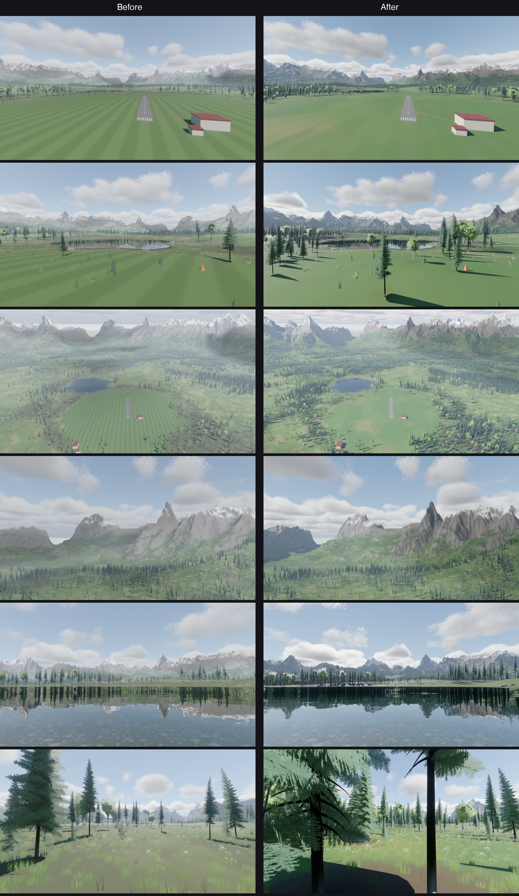
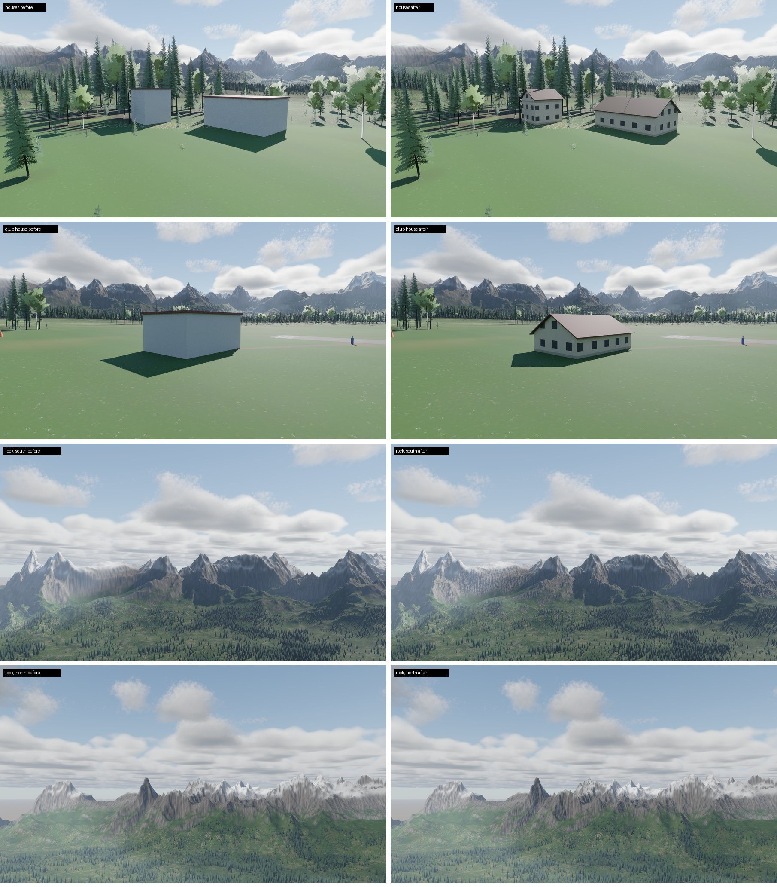

# Visualization

The 3D view and the place it shows. The engine draws a **scene** (where each plane is, how it
sits, what its props and control surfaces are doing, and the wind) and knows nothing of where
the scene comes from. Two sources fill it in:

- **the simulator** (`sim001`), from its flight model, every frame;
- **a real plane** (`sim001_view`), from its MAVLink telemetry.

The view has two jobs: to show a pilot a flight, and to make pictures that a camera-based system
can learn from. The second asks the view to look like the real world, so it is held up against
photos (see [Looking like a photo](#looking-like-a-photo)).

## Modules

| Crate | Path | Role |
| --- | --- | --- |
| `visualization_mappack` | [mappack/](mappack) | The map pack format: the config in `maps/<name>/map.txt` and what `mapbuild` writes to `build/`, read back by the world and the console. No dependencies |
| `visualization_world` | [world/](world) | The place: ground heights, water, trees and buildings, for the procedural Alpine Valley or a real place from a map pack. The physics flies over it too, so it has no renderer in it (only `glam`) |
| `visualization_mapbuild` | [mapbuild/](mapbuild) | `mapbuild`: builds a real place's map pack from USGS lidar and imagery and OSM. |
| `visualization_engine` | [engine/](engine) | The Bevy view: terrain, forest, grass, water, clouds, sky and haze, the planes, the cameras (line of sight, chase, nose), the loading screen, and pictures from set views (`capture`). `EnginePlugin`, then fill in `Scene` before `EngineSet::Draw` |
| `visualization_telemetry` | [telemetry/](telemetry) | A real plane's MAVLink (`HOME_POSITION`, `GLOBAL_POSITION_INT`, `ATTITUDE`) turned into where the view draws it. No Bevy, so it runs in tests. The acceptance test of [Watching a real plane](../../expectations/05-visualization) runs here |
| `visualization_viewer` | [viewer/](viewer) | `sim001_view`: the engine and the telemetry together, in a window |

Each module depends only on the ones above it. The engine depends on `simulation_aircraft` for the
shape of the plane, and on `simulation_physics` only for the obstacle type.

## Watching a real plane

```bash
cargo run --release -p visualization_viewer -- --udp 14550
```

`sim001_view` listens for MAVLink on UDP port 14550, where ArduPilot and MAVProxy send it by
default (or `--tcp ADDR`, such as SITL's spare port `127.0.0.1:5762`). Home is the pilot box:
the plane's `HOME_POSITION`, or `--home LAT,LON,ALT`, or the map pack's home with `--map NAME`.
C changes the view and Z switches the auto-zoom, as in the sim.

With no plane, try it with a pretend one that flies circles:

```bash
cargo run --release -p visualization_telemetry --example circuit
```

## Pictures for camera systems

```bash
cargo run --release -p visualization_viewer -- --capture shots \
  --at "creek=-93,1.1,-262,-300,15,-262,55" --at "field=10,1.7,20,-200,25,-500,60"
```

Each `--at NAME=x,agl,z,tx,tagl,tz[,fov]` is a camera (east, height above the ground, south) and
the point it looks at, with a vertical field of view in degrees. Once the world has loaded, each
view is held for four seconds so the ray tracer settles, and the 3D view is saved at full
resolution, with no HUD, as `shots/NAME.png`. The sim's `SIM001_VIEW` environment variable pins its
camera the same way. `towers_view` takes the same options for the Towers valley (rasterized), with no game server running.

## Looking like a photo

The reference is a subalpine meadow by a still creek: narrow firs, a meadow running to the
water, a clear stony bed in the shallows, reflections, cumulus to the horizon, and haze on the
far ridges. What the view does for each:

| In the photo | In the view |
| --- | --- |
| Narrow, dark spires of subalpine fir | Firs and spruce are 0.55 to 0.85 times as wide as they are tall. Aspens are only a few groves |
| Dark trees in the reflection | The ray tracer sees a smooth cone for each crown. It is darker than the crown, because a cone has no shadowed gaps between branches |
| A clear stony bed near the bank | The water is a mirror whose colour is the bed's: stones and silt (`pebble_texture`), fading with depth by vertex colour, red first. Fresnel shows the bed where you look down and the reflection where you look across |
| Grass to the water's edge, a dark wet margin, cobbles | The shore is sedge and moss, with a wet band just above the water and about 900 cobbles along the waterline |
| A field of cumulus, down to the horizon | About 500 flat-bottomed clouds out to 16 km, with sunlit tops and blue-grey bases |
| Blue haze on the far mountains | A depth-based aerial perspective pass (`haze.rs`): air that thins with height, about 60 km of visibility (a clear day; the raster fog uses the same), brighter towards the sun |
| A warm, yellow-green meadow | The baked grass colours are warmed a little and pulled a little towards grey |
| Long shadows across the picture | A mid-afternoon sun, 38° high in the west-south-west: the views up the valley are side-lit |
| A camera's colours | A filmic curve (AgX) and a camera's standard picture profile on top: 8% more saturation, 3% more midtone contrast |
| A mown field is not a carpet | Wet, dry and clover patches tens of metres across, under faint mowing stripes (about 5%) |
| Woods, not parkland | Trees up to 7 m apart within 1 km of the field, so the thickest stands have 150 to 200 trees a hectare; 13 m apart further off |
| Needles under the trees, grass in the gaps | `canopy` (in the world) says how much of the sky the crowns hide at a point. Under the crowns of the woods is brown needle litter and moss, and the grass is thin; the sunny gaps between them are meadow. A lone tree in the meadow drops too little to bury the grass |
| Gullies down the rock faces | Noise smeared down the fall line (seen over 60 m, not every bump), per texel: dark runnels and pale ribs. The horizontal strata are fainter |
| A clean lens | A little bloom (0.06): a glow round the sun and bright clouds, not a veil over the shadows |
| The FPV camera's picture | The nose camera has a small wide-angle lens: barrel distortion (cropped at the edges), dark corners and faint colour fringes. Its sensor (`sensor.rs`) has a shutter open for 1/150 s, so what moves across the picture smears along its motion (the same at any frame rate, and read where the upscaled main pass drew it), and a grain that moves every frame: about 3% at mid grey, 13% in deep shade. The other views, the sensor feed and pinned pictures have none of these |
| Rock that is broken, not smooth | Each terrain chunk has a normal map of the relief its mesh is too coarse for: crags and runnels down the fall line on rock (the grooves of the gullies), filled in by snow; a few centimetres of bumps in soil |
| Cliffs, not drapes | Faces steeper than 60° are split from their chunk (`cliff.rs`) and drawn as rock laid on from the side, so it runs up the face instead of hanging from the top: a 48 m tile of cracks and ledges the colour of the baked rock, with its normals turned as if the face stood out in buttresses and fell back in gullies. The shape is the terrain's to the vertex. It matters most on the walls round the Towers valley (400 m in 100 m) |
| Houses, not boxes | A building fills its box under a 30° gable roof (ridge along the long side, 0.5 m overhang), or a flat one if its short side is over 20 m. Plastered walls, a window in every 3 m bay of every storey, a darker plinth; matte clay, slate or wood roofs. At a real place the roof keeps the aerial photo's colour |

Before and after (ray traced, pinned views, so without the FPV lens): the drone over the field and
low over the meadow, 250 m up, the peaks, the creek and the woods:



Then the houses and the rock's relief (left before, right after; the FPV camera's shutter and
grain only show in flight, so they are not here):



What it does not do yet:

- **Clouds in the lake, and cloud shadows.** The clouds are camera-facing puffs, which the ray
  tracer cannot see. Solid stand-ins reflect as dark rocks, since a solid has none of a cloud's
  inner glow. Emissive ones become lights in Solari and take the sun's samples, which darkens
  the whole scene.
- **Scree and trees on the mountain faces.** The rock has gullies and relief, but no scree
  fans below it and no trees scattered across it.
- **Haze in the rasterized view** uses Bevy's `DistanceFog`, which is close to the ray-traced
  pass but not the same.
