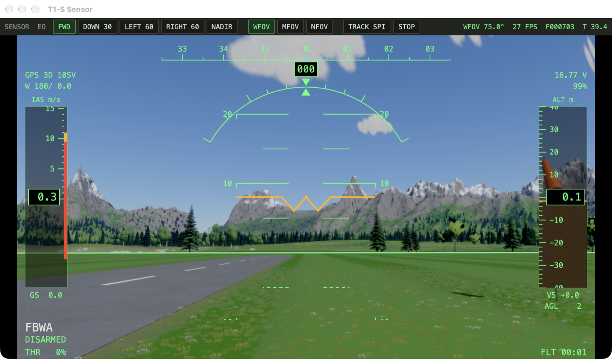

# T1-S Ground Control Station


A [GPUI](https://gpui.rs) ground control station for ArduPlane SITL running on the t1s_sim flight model. The layout follows a fixed-wing UAS console: bezelled screens on a single window.

| Screen | What it shows |
| --- | --- |
| **Primary flight display** | Synthetic horizon with HUD symbology: pitch ladder, roll scale with sky pointer, flight path marker, heading tape with nav-bearing bug and track marker, airspeed tape with stall bands and target-speed bug, altitude tape with target-alt bug and the sim's terrain under the aircraft, AGL, mode, armed, throttle, GPS, battery, wind, flight time and target distance/ETE. |
| **Tactical situation** | A top-down orthophoto of the sim's own valley (exported from the sim), plus range rings, home, the vehicle mission (with loiter circles and the active waypoint), the flight plan being edited, the GUIDED target, the ground track, a 20 s velocity leader, wind, scale bar and a cursor readout (lat/lon, N/E, ground height, range/bearing). |
| **Vehicle command** | ARM (two-step confirm) / DISARM, and flight mode buttons. |
| **Telemetry trends** | Two-minute strip charts: altitude, IAS/GS, battery voltage/throttle. |
| **Caution / warning** | Annunciators for LINK, GPS, EKF, AHRS, BATT (per-cell), ARMED, PREARM, STALL, TERRAIN (from the sim terrain), FENCE, RC, XTRACK. Warnings flash. |
| **Systems / messages** | Telemetry readouts, EKF variances, RC and servo outputs, and the autopilot STATUSTEXT and GCS command/ACK log. |

## Station: everything at once

```bash
cd gcs && cargo run --release -- --station
```

This one command brings up the whole simulator station. It runs every prerequisite first, in the terminal, and stops with a clear message if one fails:

1. **Builds the sim** (`cargo build --release` in the repo root; a no-op when it's up to date). `--no-build` skips it.
2. **Exports the terrain map** to `gcs/assets/` if it's missing (about 8 s).
3. **Starts Docker Desktop** if the daemon isn't running.
4. **Builds the ArduPlane SITL image** from `ardupilot/Dockerfile`. The first time takes about 15 minutes. After that the build is cached, takes seconds, and picks up changes to `t1s.parm`.
5. **Starts the SITL container**, or reboots it if it's already running, so ArduPilot starts together with the new sim. A container from an older image is replaced so new parameters take effect. ArduPilot's flight logs (`.BIN`, one per boot) are kept in `logs/sitl/` in the repo. Open them in [UAV Log Viewer](https://plot.ardupilot.org) or MAVExplorer.

Then it starts **t1s_sim** as SITL's physics with the sensor feed on and its window placed in its pane, and opens **the console** and **the sensor feed**. `cargo run` builds the GCS itself.

The panes are laid out over your displays (the layout code is in `station/src/layout.rs`):

| Displays | Layout |
| --- | --- |
| 1 | Console on the left (58%). On the right, the sensor feed (sized for a 16:9 picture) sits above the sim view. |
| 2 | Console on the main display. The other display has the feed and the sim side by side, or stacked if it's portrait. |
| 3+ | Console on the main display, the feed on the nearest display to its left, and the sim on the nearest remaining one. |

The panes use each display's usable area, below the menu bar and beside the Dock. The title bar height is measured from AppKit. `--map cypress` or `--map berkeley` flies a real place (see [maps/README.md](../maps/README.md)). The station builds the map pack if needed and starts SITL with its home at that place's pilot box, and the tactical map shows the place's aerial photo. `--direct` starts the sim with your sticks flying it through the sim's own modes, while ArduPilot runs alongside for telemetry. `J` or D-pad down in the sim toggles it, and the console shows **DIRECT** while it's on. `--layout single` tiles everything on the main display even with more displays attached. `--raster` runs the sim without ray tracing. Closing the console stops the sim, and so does killing the GCS, because the sim exits with its parent.

The windows are frameless: content runs under a transparent title bar, with no title or window buttons. Corners are concentric with macOS's 17 pt window radius. Drag a header strip (the console's top bar, or the sensor toolbar's status area) to move a window, and quit with Cmd+Q.

Below 1500 pt wide, the console switches to two columns. When the sensor window is open, the flight display is left to the feed's HUD.

## Sensor feed



The sim renders a gimballed camera just ahead of and below the nose. It streams the frames over TCP 5600 while a viewer is connected (`t1s_sim --feed`, protocol in `station/src/feed.rs`). Frames are raw BGRA at 320×240 and up to 30 fps, which suits loopback well. With no viewer connected, the camera renders a tiny frame and nothing is read back. A second ray-traced view is expensive on the GPU, so the feed is small by default; `--feed-size 640x480` gives a sharper image at some cost in frame rate.

- **Looking straight ahead (FWD):** the flight HUD is drawn over the video. Its pitch scale matches the camera's field of view, so the horizon and flight path marker line up with the picture.
- **Slewed:** sensor symbology replaces the HUD. You get a reticle, azimuth and elevation scales, the line-of-sight bearing, and the **SPI** (the sensor point of interest: where the line of sight meets the sim's terrain), with coordinates, ground elevation and slant range. The SPI and line of sight also appear on the tactical map.
- **Controls:**
  - Drag to slew. The gimbal is body-fixed and moves at 120°/s.
  - Scroll to zoom from 4° to 90°. WFOV, MFOV and NFOV are presets.
  - FWD, DOWN 30, LEFT/RIGHT 60 and NADIR are preset pointings.
- **Tracking:** click the picture, or use **LOOK** on the map, to track a ground point. The GCS re-aims the gimbal from live attitude about 30 times a second. **TRACK SPI** locks the current SPI and **STOP** releases it.

To use the feed without `--station`, run the sim with `--ardupilot --feed` and the GCS with `--sensor`.

## Run

```bash
# once: export the map + height grid from the sim (about 8 s, writes gcs/assets/)
cargo run --release -- --export-map gcs/assets

# the usual stack
cargo run --release -- --ardupilot      # sim as physics backend
ardupilot/run_sitl.sh                   # ArduPlane SITL in Docker, MAVLink on tcp:5760

# the GCS
cd gcs && cargo run --release
```

The macOS build compiles GPUI's Metal shaders, so it needs the Metal Toolchain:
`xcodebuild -downloadComponent MetalToolchain`.

Options:

- `--connect ADDR`: any rust-mavlink address. The default is `tcpout:127.0.0.1:5760`. Use `udpin:0.0.0.0:14550` for MAVProxy `--out`. SITL's port 5760 takes one client, so close QGroundControl first or give it another port.
- `--origin LAT,LON,ALT`: SITL's `--home`, which is the sim's pilot box. Map positions are metres from this point. The default matches `ardupilot/start.sh`.
- `--assets DIR`: where the exported map lives (default `gcs/assets`). Without it the map falls back to a 100 m grid.
- `--station`, `--layout single`, `--raster`: see above. `--sensor` opens the feed window and `--feed HOST:PORT` sets the feed address.
- `--expect [SUITE] [--docs DIR]`: runs the acceptance tests in `expectations/` against the console and exits. The driver sends real mouse events into the console window (to where each button is painted) and reads the state back, so it needs a vehicle: use `--station --expect`. With `--docs`, it writes the manual with screenshots (macOS `screencapture`, which needs the Screen Recording permission) and merges the results with the sim's. Tests that need the mission file, terrain check, survey grid, measuring or the sim window stay "not supported yet".
- `--aircraft ID`: with `--station`, the plane to fly (`t1s-vtol`, the default, or `t1s-ranger`, which has no flight controller and so no station). For a VTOL the console adds the Q modes (QSTABILIZE, QHOVER, QLOITER, QLAND, QRTL) to its mode buttons.
- `--autotest`: for SITL only. It uploads a circuit, reads it back, arms, flies AUTO, sends a GUIDED goto, then flies RTL, and prints `AUTOTEST PASS/FAIL`. With the t1s_sim physics, AUTO waits for a throw, so if nothing happens for 20 s it launches in FBWA with an RC throttle override and then hands back to AUTO.

## Using the map

- Drag to pan. Scrolling zooms about the cursor, or about the aircraft while **FOLLOW** is on.
- **GOTO**, then click: fly there and loiter (`DO_REPOSITION`, switches to GUIDED) at the current altitude.
- **PLAN**, then click: add waypoints at the plan altitude (**ALT− / ALT+**). Right-click removes the last one. **+TKOF** puts a takeoff at home first, and **+RTL** ends the mission with RTL.
- **UPLOAD** replaces the vehicle mission. **DOWNLOAD** reads it back. **EDIT** copies the vehicle mission into the plan. **WP1** restarts it.
- For a hand-launched AUTO mission: +TKOF, click waypoints, +RTL, UPLOAD, then **AUTO** and **ARM**. Then throw the plane in the sim (throttle up or Space).

## Code

- `src/link.rs`: the MAVLink thread. It handles the heartbeat, stream rates, commands with ACK logging, and mission upload and download with retries, and it reconnects on its own.
- `src/vehicle.rs`: the shared vehicle state and history.
- `src/geo.rs`: the origin-relative tangent plane, plus the exported map and height grid.
- `src/ui/`: `app.rs` (layout and panels), `hud.rs`, `map.rs`, `charts.rs`, `draw.rs` (canvas helpers) and `theme.rs`.
- `src/feed.rs`: the sensor feed client, gimbal commands and ground-point tracking.
- `src/station.rs` and `src/screens.rs`: launching SITL and the sim, display geometry and title bar height.
- `src/ui/sensor.rs`: the sensor window.
- `src/expect.rs`: the GPUI driver for the expectation framework (`--expect`).
- `src/autotest.rs`: the scripted end-to-end flight. It also works with `--station`.
- `../station/`: shared with the sim. It holds the feed wire protocol and the layout planner, and has no dependencies.
